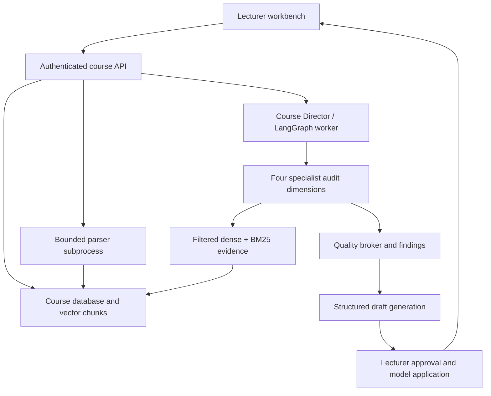

# Lectio revision 2 architecture

The source project remains Python/FastAPI, Streamlit, async SQLAlchemy, LangGraph and Groq. The safety-motivated change is vector storage: dense embeddings now live inside the existing source-chunk transaction, rather than an independent ChromaDB REST service.

Evidence: source UUID, checksum, extracted chunk UUID, page/slide/section and corpus/model version are retained. Every generated support quotation is validated against supplied chunks; unknown sources and invented quotations fail validation. This proves source identity and quotation integrity, not semantic entailment of every proposal. Inference and proposed educational content remain labelled for lecturer review.

Roles: Course Director loads course constraints and snapshots, controls dependency order and bounded graph routing. Four specialists compare metadata/content, content/assessment, metadata/assessment and content/planned delivery. Deterministic tests use explainable retrieval/verb heuristics; live mode optionally adds schema-validated specialist model inference. The broker consolidates duplicates, ranks evidence and priority, flags possible opposing actions and retains alternatives. Content-generation agents create structured objective/exercise/quiz/description proposals from retrieved context. Stakeholder persistence and lecturer APIs retain decisions, rationale and accepted snapshots.

Human control: finding approval does not approve generated content. Draft revision does not approve the revision. Model application requires explicit content approval and another explicit user action. The source upload is not overwritten. Applying an approved change or editing the model makes earlier matrix results stale; lecturers can rerun alignment.

Orchestration: audits are admitted under a database lock, commit their run record before process launch, record actual AgentStep duration/status/tokens and have wall-clock limits and cancellation. Specialist failures remain failed dimensions with actionable logs; they are not fabricated as successes. Admission is shared across processes, but scheduler ownership, cancellation and restart recovery remain single-worker prototype behaviour. Paperclip can operate the outer identity/checkout/run/review protocol via its process adapter.

Resource controls: uploaded byte counts, MIME/signatures and Office archive expansion are bounded. Parsing runs in a subprocess with timeout and Linux CPU/address-space limits; ingestion has two slots. Course exact-vector retrieval is bounded to 10,000 source chunks. Larger deployments need an indexed vector store and durable job dispatch. Windows needs OS/container limits for equivalent parser memory isolation.
