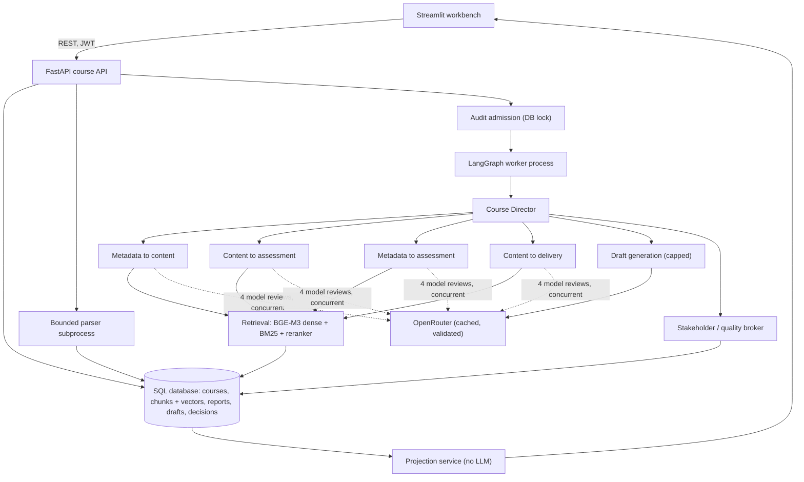

# Architecture

Python stack: Streamlit frontend, FastAPI backend, async SQLAlchemy, LangGraph orchestration, OpenRouter for generation, local BGE-M3 embeddings and a multilingual cross-encoder reranker.

## Components
| Area | Location | Notes |
|---|---|---|
| API routes | `backend/api/v1/routes/` | auth, courses, artefacts, workbench (evidence, generate, apply, export, projection), workflow (runs, reports, approvals), admin |
| Auth | `backend/auth/` | PyJWT, bcrypt, refresh rotation and revocation, role hierarchy, login throttling |
| Ingestion | `backend/rag/parsers`, `rag/chunking`, `services/safe_parser.py` | subprocess with timeout and limits; a heading is merged with the text under it |
| Embeddings | `backend/rag/embedding/bge_embedder.py` | `BAAI/bge-m3`, 1024-d, content-addressed disk cache, query memo |
| Retrieval | `backend/rag/retrieval/`, `vector_db/sql_vector_store.py` | exact cosine in SQL-stored vectors, BM25, `mmarco-mMiniLMv2` reranker; vectors of another embedding model are ignored |
| Course model | `services/course_model.py`, `services/auto_derive.py` | stated outcomes (EN/DE) first; derivation from taught material only when none exist |
| Agents | `backend/agents/` | director, four dimension agents, rule checks, `live_review.py` model review, generation agent, stakeholder |
| LLM client | `backend/llm/openrouter.py` | httpx, validated-result cache, one fallback model, daily-quota detection |
| Projection | `backend/services/projection.py` | re-checks gaps against approved drafts, no model calls |
| Frontend | `frontend/` | Streamlit pages, shared client with keep-alive pool and short GET cache |

## Key decisions
| # | Decision | Why |
|---|---|---|
| 1 | Dense vectors live in the chunk row (SQL), not in ChromaDB | the audited ChromaDB release had advisories without fixes; one transaction for text and vectors; course-isolated access |
| 2 | OpenRouter with a free default model and one fallback | no cost; models are configurable and the client survives rate limits |
| 3 | `BAAI/bge-m3` and a multilingual reranker | German and English retrieval; same 1024 dimensions as before, so a model guard prevents mixing spaces |
| 4 | Cache only output that passed validation | a bad answer is retried, never replayed; cache hits cost zero tokens |
| 5 | Model review findings must cite supplied evidence; unverifiable findings are dropped one by one | prevents invented sources without losing a whole review |
| 6 | Confirmations are returned separately from problems | good news is not a gap |
| 7 | The four model reviews start concurrently | wall time is the slowest call, not the sum (they need no results from each other) |
| 8 | Automatic drafts for the worst gaps only (default 4), one per gap type first | quota friendly; the lecturer can ask for more |
| 9 | Projected score = verified + (100% - verified) x severity-weighted share of gaps addressed, capped at 95%, share spread over at least three warning weights | an honest estimate that one finding cannot inflate; verified scores change only through a real audit |
| 10 | Streamlit with a plain, larger-type theme | simple and familiar; a dark "Console" redesign was built and set aside |
| 11 | Single API worker for the in-process scheduler | prototype scope; a durable queue is needed for several instances |

## Human control
Finding approval does not approve generated content. A draft revision does not approve itself. Applying an approved draft needs an explicit action and marks earlier results stale. Source uploads are never overwritten.

## Evidence integrity
Each generated support quotation is validated against the chunks supplied. A valid citation proves source identity and quotation integrity, not that the claim follows from the source: the lecturer still verifies conclusions.

## Resource controls
Upload size, MIME and signature checks, Office archive expansion limits; parsing in a subprocess with timeout (and CPU/memory limits on Linux); two ingestion slots; exact-vector retrieval bounded to 10,000 chunks per course; audit wall-clock limit and cancellation; LLM output caps and one fallback attempt.

## Limits
Audit admission uses a database lock, but dispatch, cancellation and restart recovery are single-worker. The database layer creates missing tables at start-up and is not a migration system. Paperclip is reachable through a process adapter only.
